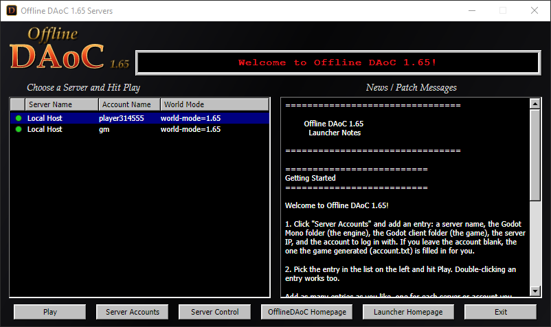

# Offline DAoC 1.65 Launcher

A small retro-style launcher for [OfflineDAoC-True165](https://github.com/shadowofze/OfflineDAoC-True165).
It keeps a list of server accounts and starts the game client for the one you pick.

Used Claude to code in C# with [Avalonia](https://avaloniaui.net), so the same code runs on Windows, Linux and macOS.




## Running it

Windows: run `dist\win-x64\OfflineDAoCLauncher.exe`. It is a single file with .NET built in, so it can be
copied anywhere and needs nothing installed.

## Using it

| Button | What it does |
| --- | --- |
| **Play** | Starts the client for the entry selected in the list. Double-clicking an entry or pressing Enter does the same. Play is greyed out until an entry is selected and its server shows online (green dot); hover over it to see why. |
| **Server Accounts** | Add, edit and delete entries. |
| **Server Control** | Opens the OfflineDAoC server control panel for the selected entry by running `START OFFLINE DAOC TRUE 1.65.cmd` from its install folder, two folders above the Godot client folder (`C:\OfflineDAoC-True165` for `C:\OfflineDAoC-True165\new-client\godot`). If the control panel (`runtime\OfflineDAoC.exe`) is already running, its window is brought to the front instead of starting a second copy. The control panel is a Windows program: on Linux and macOS it is started with Wine (`wine cmd /c`), and a running copy is brought forward with `xdotool` or `wmctrl` (Linux, X11) or System Events (macOS, may ask for Accessibility permission the first time). |
| **OfflineDAoC Homepage** | Opens the [OfflineDAoC-True165](https://github.com/shadowofze/OfflineDAoC-True165) page in your browser. |
| **Launcher Homepage** | Opens this launcher's page, [OfflineDAoC_GodotClient_Launcher](https://github.com/rsandersjr/OfflineDAoC_GodotClient_Launcher), in your browser. |
| **Exit** | Closes the launcher. |

The dot to the left of each server name shows whether that server is running: green is online, red is
offline, grey is not checked yet. Hover over it to see the address checked. Every 5 seconds the launcher
opens a TCP connection to the server's login port. The address and port come from the install's server config,
`runtime\server\config`, two folders up from the entry's Godot client folder. The file used is the one
`runtime\data\world-mode.txt` names (`serverconfig-165.xml` for 1.65 Mode), else `serverconfig.xml`.
Without a config the entry's Server IP and port 10300 are used.

Each server account has:

| Field | Default | Notes |
| --- | --- | --- |
| Server Name | `Local Host` | Any label you like. |
| Godot Mono Folder | | The engine: the folder holding the Godot Mono executable. |
| Godot Client Folder | | The game: the `godot` folder holding `project.godot`. |
| Server IP | `127.0.0.1` | |
| Account Name | | |
| Account Password | | |
| World Mode | `world-mode=1.65` | Passed to the client as `--world-mode=1.65`. |

### Which folders to pick

- **Godot Mono Folder**: the folder that contains `Godot_v4.7.2-stable_mono_win64.exe`.
- **Godot Client Folder**: the game's `godot` folder, the one that contains `project.godot`. Picking the
  folder one level above it works too; the launcher saves the `godot` folder inside it.

The two can be anywhere; they do not have to sit near each other. The form shows under each box whether
it found the engine and the game before you save. If a `godot` folder sits next to or above the engine
folder you pick, the client box is filled in for you, and you can change it.

A new entry starts with the folders of the entry added last, so both are usually picked only once.

### The generated account

The game writes the account it generates for you to `account.txt`:

```
Account: username_here
Password: password_here
```

When the Account Name box is empty and a client folder is picked, the launcher fills in Account Name and
Account Password from that file. It reads the install's `runtime` folder: for the client folder
`C:\OfflineDAoC-True165\new-client\godot` that is `C:\OfflineDAoC-True165\runtime\account.txt`. An account you
typed in yourself is never replaced. To pull the generated account into an existing entry, clear its
Account Name and pick the client folder again.

### What Play runs

From the folder above the client folder:

```
Godot_v4.7.2-stable_mono_win64.exe --path godot -- --server=<Server IP> --account=<Account Name> --password=<Account Password> --<World Mode>
```

## Where accounts are saved

| Platform | File |
| --- | --- |
| Windows | `%APPDATA%\OfflineDAoCLauncher\accounts.json` |
| Linux | `~/.config/OfflineDAoCLauncher/accounts.json` |
| macOS | `~/Library/Application Support/OfflineDAoCLauncher/accounts.json` |

On Windows, passwords in that file are encrypted for your Windows user (DPAPI). Linux and macOS have no
built-in equivalent, so there the password is only encoded and the file is readable by your user alone.
On every platform the password is handed to the client on its command line, because that is how the client
takes it.

To keep the accounts somewhere else, set the `OFFLINEDAOC_LAUNCHER_ACCOUNTS` environment variable to the
full path of the file to use.

## Customising

Put either of these next to the launcher executable:

- `news.txt` replaces the text in the News / Patch Messages panel.
- `logo.png` replaces the title mark in the top-left corner (about 190 x 80).

## Building

Needs the [.NET 10 SDK](https://dotnet.microsoft.com/download).

Run from source:

```
dotnet run
```

Publish a standalone single-file build:

```
dotnet publish -c Release -r win-x64 -o dist/win-x64
dotnet publish -c Release -r linux-x64 -o dist/linux-x64
dotnet publish -c Release -r osx-arm64 -o dist/osx-arm64
dotnet publish -c Release -r osx-x64 -o dist/osx-x64
```

`osx-arm64` is for Apple Silicon Macs (M1 and newer), `osx-x64` for Intel Macs. All of them build from any OS. Only the Windows build has been run and tested so far. On Linux and macOS the
launcher looks for `Godot_v*_mono_linux.x86_64` and `Godot_mono.app` in the folder you pick; mark the
published launcher executable with `chmod +x` before running it.
